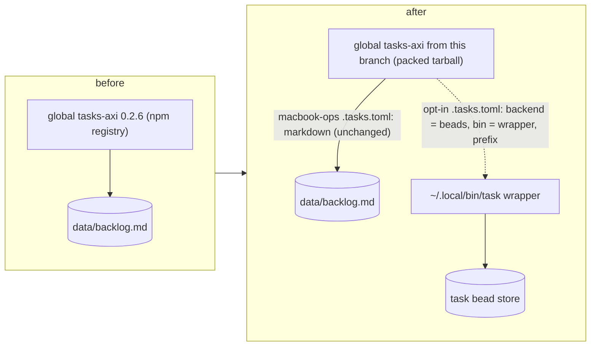

# Personal main: before -> after

| Check | Result |
| --- | --- |
| `pnpm build`, `pnpm lint` | clean |
| `REQUIRE_BD=1 pnpm test` | 501 passed, 1 skipped (bd 1.1.0-rc.1) |
| `pnpm run build:skill -- --check` | up to date |
| `tasks-axi list` in macbook-ops, markdown backend | 39 items, output identical before and after the install |
| Wrapper-style beads config on a temp store | add, list, update, start, ready, done, show, mirror, prefix guard all pass |
| Live task/brain stores | not touched |
